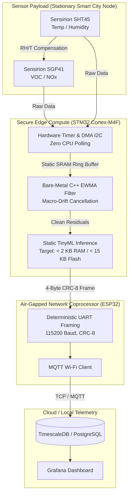

# Edge AI Telemetry Node

**Project Status:**
- **Host-Verified Scaffolds & DSP Logic (Completed):** Dual-MCU architecture, Python MQTT/TimescaleDB ingestion pipeline (4-byte CRC-8 framed state parser), ESP-IDF UART-to-MQTT gateway scaffold, and zero-heap C++17 STM32 firmware modules (`StaticRingBuffer`, `EwmaBaselineFilter`, Sensirion SHT45/SGP41 CRC-8 codec, and host unit tests).
- **Phase 2 — Target Silicon Integration (In Progress):** Non-blocking STM32 DMA I2C state machine (`sensor_pipeline.h`), STM32CubeIDE target build (`STM32F303ZETx`), Edge Impulse environmental model `.map` footprint verification, and live desk hardware benchmarks.
- **Phase 3 — Future Roadmap:** STM32 GPIO wake-pin control for ESP32 deep-sleep power gating (`Wake-on-Anomaly`) once the always-on end-to-end pipeline is benchmarked.

## Overview
This project is a heterogeneous, dual-MCU edge telemetry architecture designed for Cyber-Physical Systems (CPS) and Smart City infrastructure. It pairs an ARM Cortex-M4F (STM32 Nucleo-F303ZE) for hard real-time signal processing with an ESP32 network coprocessor.

The system addresses a core challenge in environmental Edge AI: **MOX sensor drift**. Rather than relying on static neural networks that trigger false anomalies during natural diurnal temperature and humidity shifts, the pipeline uses a bare-metal C++ EWMA filter to absorb slow baseline drift and feeds only the clean residuals into a statically allocated TinyML inference engine.

## System Architecture

## Core Engineering Constraints

1. **Zero Dynamic Allocation:** No `malloc`/`free` or heap-backed containers in the firmware pipeline. Ring buffers, codecs, and EWMA state are statically allocated at compile time.
2. **Non-Blocking Acquisition Target:** Hardware-timer and DMA-driven I2C acquisition (avoiding `HAL_Delay` polling loops in the main loop).
3. **Bounded Memory Footprint Target:** Static TinyML inference budget bounded to **< 2 KB RAM** and **< 15 KB Flash** (informed by an earlier 1.4 KB RAM / 12.1 KB Flash Float32 Edge Impulse prototype; environmental `.map` verification is part of Phase 2).
4. **Physical-Layer Compensation:** SHT45 temperature and relative humidity are encoded per Sensirion Table 12 and cross-fed directly into SGP41 measurement commands (`0x26 0x19`) prior to EWMA filtering.
5. **Air-Gapped Deterministic UART Framing:** The STM32 compute core remains physically isolated from Wi-Fi/TCP/IP. Raw sensor readings never leave STM32 SRAM; only a fixed **4-byte CRC-8 state frame** (`[0xAA][SEQ_ID][STATE_FLAG][CRC8]`) crosses `UART4` at `115200` baud for integrity validation and dropped-frame detection.

## Repository Layout

* `stm32_firmware/` — Zero-heap C++17 headers (`telemetry_protocol.h`, `ring_buffer.h`, `ewma_filter.h`, `sensirion_codec.h`) and host `g++` unit/drift tests (`tests/test_pipeline.cpp`).
* `esp32_gateway/` — ESP-IDF UART-to-MQTT coprocessor firmware (`UART_NUM_2` stream framer → Mosquitto MQTT).
* `telemetry_backend/` — Python `paho-mqtt` subscriber, TimescaleDB ingestion bridge, and SQL schema (`telemetry_events`).

## Technology Stack

* **Hardware:** STM32 Nucleo-F303ZE, ESP32 DevKit V1, Sensirion SGP41, Sensirion SHT45.
* **Firmware:** Bare-Metal C/C++17, STM32 HAL/LL, ESP-IDF.
* **AI & DSP:** Edge Impulse (TinyML), Exponentially Weighted Moving Average (EWMA) C++ filters, Sensirion CRC-8 (`0x31`).
* **Telemetry Pipeline:** Python, Mosquitto (MQTT), TimescaleDB (PostgreSQL), Grafana.
