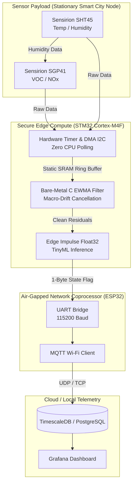

# Edge AI Telemetry Node

**Project Status:** 
- **Phase 1 (Complete):** Systems architecture, DSP logic pipeline, and TinyML footprint verified.
- **Phase 2 (In Progress):** Consolidating bare-metal C++ DMA I2C sensor drivers for the Sensirion SGP41/SHT45 environmental payload.

## Overview
This project is a heterogeneous, dual-MCU edge telemetry architecture designed for Cyber-Physical Systems (CPS) and Smart City infrastructure. It pairs an ARM Cortex-M4F (STM32) for deterministic, hard real-time signal processing with an ESP32 network coprocessor. 

The system is engineered to solve a critical issue in environmental Edge AI: **MOX sensor drift**. Rather than relying on static neural networks that hallucinate false anomalies during natural daily temperature/humidity shifts, this pipeline utilizes a hybrid C-code EWMA filter to mathematically absorb macro-drift, feeding only the clean residuals into a statically allocated TinyML inference engine.

## System Architecture

## Core Engineering Constraints

This architecture enforces strict firmware and memory discipline to ensure bounded execution latency and eliminate network-induced thread jitter.

1. **Zero Dynamic Allocation:** Absolute ban on `malloc`/`free`. All SRAM ring buffers and memory arenas are statically allocated at compile time to prevent memory fragmentation.
2. **Deterministic Ingestion:** Zero blocking delay loops (`HAL_Delay`). Data ingestion is strictly driven via hardware timers and Direct Memory Access (DMA).
3. **Hardware-Aware Neural Network:** The Edge Impulse Float32 C++ inference model operates under a highly restricted memory footprint, explicitly bounded to **< 2 KB RAM** and **< 15 KB Flash**.
4. **Physical-Layer Compensation:** Before mathematical filtering occurs, relative humidity from the SHT45 is cross-fed directly into the SGP41 command registers to dynamically adjust the Sensirion ASIC’s resistance baselines at the silicon level.
5. **Secure Network Isolation:** The STM32 compute core is physically air-gapped from the TCP/IP stack. Raw environmental data is processed and destroyed locally in STM32 SRAM. Only an abstracted, 1-byte anomaly classification state flag is transmitted across the UART boundary to the ESP32.

## Technology Stack

* **Hardware:** STM32 Nucleo-F303ZE, ESP32 DevKit V1, Sensirion SGP41, Sensirion SHT45.
* **Firmware:** Bare-Metal C/C++, STM32 HAL/LL, ESP-IDF.
* **AI & DSP:** Edge Impulse (TinyML), Exponentially Weighted Moving Average (EWMA) C-filters.
* **Telemetry Pipeline:** Python, Mosquitto (MQTT), TimescaleDB (PostgreSQL), Grafana.
